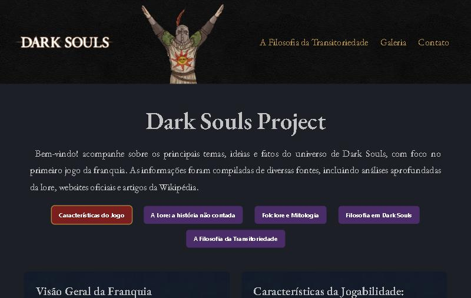

# Dark Souls Project

Site de fã sobre **Dark Souls** (primeiro jogo da franquia), criado para praticar HTML, CSS e JavaScript com foco em layout responsivo, acessibilidade e desempenho.

**Ver online:** https://hugohendrix.github.io/dark-souls-project/



## O que o site tem

- **5 abas de conteúdo:** características do jogo, lore, folclore e mitologia, filosofia em Dark Souls e a filosofia da transitoriedade.
- **Galeria de imagens** com visualização ampliada, navegação por setas e fechamento com a tecla Esc.
- **Seção "Sobre o projeto"** com fontes e créditos e links para o código e o portfólio, além de botão de voltar ao topo e efeito parallax.
- **Visual sombrio** com paleta própria e fontes góticas (EB Garamond, MedievalSharp, Pirata One e UnifrakturCook).

## Decisões técnicas

- **Abas acessíveis (ARIA):** todo o texto já está no HTML e o JavaScript mostra um painel por vez. Funciona com teclado (setas, Home e End), cada aba tem um endereço próprio (`#lore`, `#folclore`) e, sem JavaScript, todo o conteúdo fica visível.
- **Responsivo:** testado a partir de 375 px de largura, sem rolagem lateral.
- **Desempenho:** imagens em WebP, carregamento preguiçoso (`loading="lazy"`) e sem bibliotecas externas além das fontes.
- **SEO:** título e descrição próprios, Open Graph, Twitter Card, `canonical`, `robots.txt` e `sitemap.xml`.

## Tecnologias

HTML5, CSS3 (variáveis, Flexbox e Grid) e JavaScript puro.

## Como rodar

Não há etapa de build. Abra o `index.html` no navegador ou, se preferir um servidor local:

```bash
python -m http.server 8000
```

Depois acesse http://localhost:8000.

## Estrutura

```
index.html      página única com as abas, a galeria e a seção sobre o projeto
css/            reset, estilos principais, cabeçalho e rodapé
js/script.js    abas, galeria e botão de voltar ao topo
assets/         imagens (WebP) e ícones
anotacoes/      anotações de estudo feitas durante o projeto
docs/           captura de tela e o texto sobre o jogo
```

## Anotações de estudo

Na pasta [`anotacoes/`](anotacoes/) estão as notas que escrevi enquanto desenvolvia: Flexbox, Grid, parallax, formulários, meta tags, otimização de imagens e outras. Algumas descrevem decisões antigas do projeto, como o carregamento do conteúdo com `fetch`, que foi substituído pelas abas acessíveis.

## Aviso

Projeto de fã, sem fins lucrativos e sem vínculo com a FromSoftware ou a Bandai Namco. Dark Souls, seus personagens e as imagens do jogo pertencem aos seus respectivos donos.

## Autor

**Hugo Hendrix** · [Portfólio](https://hugohendrix.github.io/portfolio-hugo/) · [LinkedIn](https://www.linkedin.com/in/hugohendrix/) · [GitHub](https://github.com/HugoHendrix)
