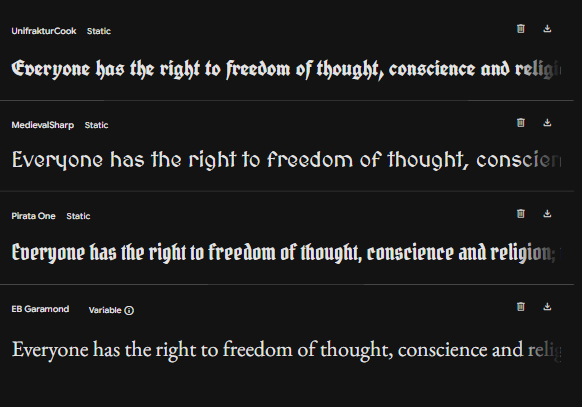

## 🖋️ Documentação de Tipografia

| Fonte              | Estilo(s) disponíveis             | Peso(s) disponíveis | Uso sugerido              |
|--------------------|----------------------------------|---------------------|---------------------------|
| **EB Garamond**    | Normal, Itálico                  | 400 a 800             | Texto corrido, parágrafos |
| **MedievalSharp**  | Normal                           | 400                 | Títulos decorativos       |
| **Pirata One**     | Normal                           | 400                 | Cabeçalhos temáticos      |
| **UnifrakturCook** | Normal (Fraktur gótica)          | 700                 | Destaques estilizados     |

---

### 💡 Sugestões de aplicação

- **EB Garamond**: Ideal para manter uma estética clássica e legível em textos longos.
- **MedievalSharp**: Ótima para dar um toque medieval em títulos ou menus.
- **Pirata One**: Perfeita para seções com temática pirata, fantasia ou aventura.
- **UnifrakturCook**: Use com moderação para criar impacto visual em elementos como logotipo, citações ou banners.

---

