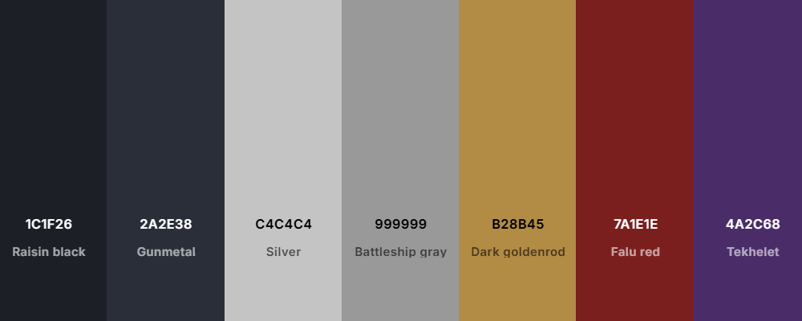

## 🎨 Documentação de Cores

| Elemento                     | Nome da Cor         | Hexadecimal |
|-----------------------------|---------------------|-------------|
| Fundo principal             | Raisin Black            | `#1C1F26`   |
| Fundo secundário            | Gun Metal            | `#2A2E38`   |
| Texto primário              | Silver Sand         | `#C4C4C4`   |
| Texto suave                 | Battleship Gray        | `#999999`   |
| Destaques dourados          | Dark goldenrod               | `#B28B45`   |
| Links e interações          | Falu Red           | `#7A1E1E`   |
| Detalhes lore               | Tekhelet        | `#4A2C68`   |

---

