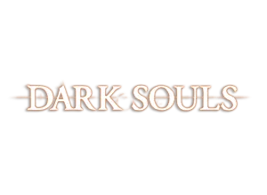

# **Dark Souls**

## **Visão Geral**

**Dark Souls** é um aclamado **RPG de Ação** e fantasia sombria desenvolvido pela **FromSoftware**. Lançado em 2011, ele se tornou um marco na indústria de videogames, popularizando o gênero "Soulslike" e influenciando inúmeros jogos.

O jogo transporta você para o desolado reino de **Lordran**, um mundo vasto, vertical e interconectado. A narrativa é propositalmente misteriosa e não linear, contada através de descrições de itens, diálogos enigmáticos e, principalmente, pelo próprio ambiente. O lema é claro: **"Prepare-se para morrer"**.

---

## **Gameplay e Dificuldade**

**Dark Souls** é famoso por sua dificuldade implacável, mas recompensadora. A morte é parte fundamental da experiência, não um fracasso.

* **Progressão Através da Morte:** Ao morrer, você perde suas almas (que servem como XP e moeda) e retorna à última **Fogueira** descansada.
* **Recuperação de Almas:** Suas almas perdidas criam uma **Mancha de Sangue** no local da morte. Se você conseguir alcançá-la sem morrer novamente, pode recuperá-las.
* **Fogueiras:** Funcionam como checkpoints, restaurando sua vida e recursos, mas também reaparecendo a maioria dos inimigos. Elas são um raro momento de alívio e reflexão em um mundo sombrio.
* **Domínio e Personalização:** O sucesso depende do seu domínio sobre o combate e da sua estratégia. Há uma vasta gama de armas, armaduras e magias para criar um personagem único.

---

## **Interações Online**

Embora a jornada seja solitária, **Dark Souls** integra elementos online de forma inovadora para conectar os jogadores:

* **Fantasmas:** Veja as ações e os locais de morte de outros jogadores como fantasmas, que podem ser uma dica ou uma armadilha.
* **Mensagens:** Deixe mensagens no chão para ajudar (ou enganar!) outros aventureiros.
* **Multijogador:** Invoque outros jogadores para **cooperação** em chefes ou invada mundos alheios para um intenso **PvP** (Jogador contra Jogador).
* **Pactos:** Una-se a facções que aprofundam a experiência multiplayer.

---

## **Lore e Temas Centrais**

O mundo de **Dark Souls** é uma fantasia sombria medieval com uma história cíclica e complexa sobre o fogo, o sacrifício e o desespero.

A narrativa gira em torno da **Primeira Chama**, que trouxe a disparidade ao mundo. Sua missão, como o **"Morto-Vivo Escolhido"**, é decidir se vai reacender essa chama e prolongar a **Era do Fogo** ou deixá-la apagar para dar início à **Era da Escuridão**.

A **solitude** é um tema central, não como solidão, mas como um caminho de autoconhecimento. Sua jornada silenciosa e implacável é o que te força a confrontar seus próprios limites e se desenvolver.

---

## **Legado**

* **Reconhecimento:** **Dark Souls** foi aclamado pela crítica, com uma nota de **89 no Metacritic**. É considerado um dos melhores jogos de todos os tempos.
* **Vendas:** A série já vendeu mais de **35 milhões de cópias**.

---
